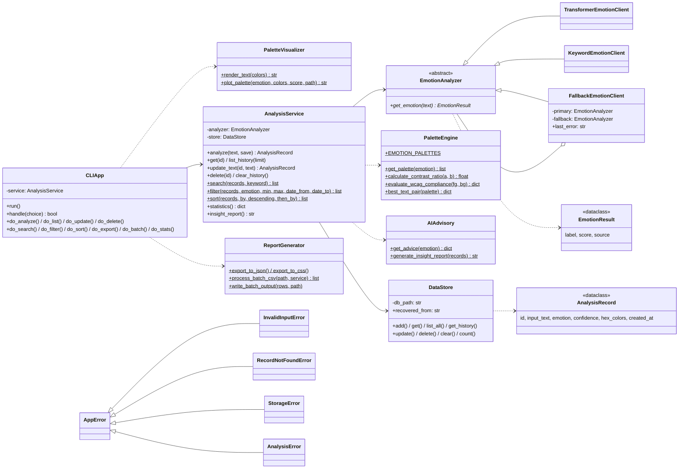

# 📋 PLAN.md — Smart Art & Palette Sentiment Analyzer Project Architecture & Planning Document

**โปรเจกต์:** Smart Art & Palette Sentiment Analyzer — ระบบวิเคราะห์อารมณ์จากข้อความและสร้างจานสีอัจฉริยะ
**รายวิชา:** CP352301 การเขียนโปรแกรมสคริปต์ (1/2569)
**อาจารย์ผู้สอน:** ผศ.บุญทรัพย์ ไวคำ

---

## 👥 สมาชิกในทีมและบทบาทหมุนเวียน

| สมาชิก | Sprint 1 | Sprint 2 | Sprint 3 | Final Sprint (ความเชี่ยวชาญ) |
| :--- | :--- | :--- | :--- | :--- |
| นายกฤษฎา สายวัน (กาย) | Planner | Coder | Debugger | Core Logic Lead |
| นายปฏิภาณ นามสีลี (ท็อป) | Coder | Planner | Coder | AI & Web Lead |
| นายปฏิพัฒน์ หอทอง (ปลั๊ก) | Coder | Debugger | Coder | DevOps Lead |
| นายภีรภัทร ด่านภูมิพัฒนา (ภีม) | Debugger | Coder | Planner | QA & Testing Lead |

---

## 🏗️ UML Class Diagram (สถาปัตยกรรมเชิงวัตถุ — Final Sprint)



### Design Patterns ที่ใช้

| Pattern | ใช้ที่ไหน | เหตุผล |
| :--- | :--- | :--- |
| **Strategy** | `EmotionAnalyzer` → `TransformerEmotionClient` / `KeywordEmotionClient` | สลับวิธีวิเคราะห์ได้โดยไม่แก้ส่วนอื่น และทดสอบด้วย Fake ได้ |
| **Decorator / Fallback** | `FallbackEmotionClient` | ห่อ analyzer หลัก ถ้าล้มให้ใช้ตัวสำรอง |
| **Repository** | `DataStore` | ซ่อนรายละเอียด SQL ไว้ใน Data Access Layer |
| **Service Layer** | `AnalysisService` | UI เรียกที่เดียว Business rule ไม่ปนกับ UI |
| **Factory** | `create_emotion_client()` | เลือก analyzer ที่ใช้ได้ตามสภาพแวดล้อม |
| **Dependency Injection** | `CLIApp(service, input_func, output_func)` | ทดสอบเมนู CLI ด้วยอินพุตจำลองได้ |

### เปรียบเทียบทางเลือก (Alternatives Considered)

| ประเด็น | ที่เลือก | ทางเลือกอื่น | เหตุผล |
| :--- | :--- | :--- | :--- |
| การเก็บข้อมูล | SQLite | JSON / CSV | SQLite ค้นตาม id ได้ทันที, มี transaction ป้องกันไฟล์เสียระหว่างเขียน, ไม่ต้องเขียนไฟล์ทั้งก้อนทุกครั้ง; JSON ง่ายกว่าแต่ต้องโหลด/เขียนทั้งไฟล์ |
| การค้นหา/กรอง | ทำใน Python บน list | SQL `WHERE`/`LIKE` | ข้อมูลระดับหมื่นแถวยังเร็ว (search ~5 ms @10k), โค้ดอัลกอริทึมเห็นชัดและทดสอบง่าย; ถ้าข้อมูลหลักล้านควรย้ายไปทำใน SQL + index |
| การเรียงลำดับ | `list.sort` (Timsort, stable) | เขียน merge sort เอง | O(n log n) เท่ากันแต่เป็น C-optimized และ stable ทำให้เรียงหลายคีย์ได้ด้วยการเรียงสองรอบ |
| AI บนเว็บ | รันบนเบราว์เซอร์ (Transformers.js) | Backend API | ไม่มีค่าเซิร์ฟเวอร์, ข้อความไม่ออกจากเครื่องผู้ใช้, รองรับผู้ใช้เพิ่มได้โดยไม่ต้องขยายเซิร์ฟเวอร์; แลกกับการโหลดโมเดลครั้งแรกนาน |

---

## 🗃️ Data Schema

### SQLite — ตาราง `palette_history` (Local Persistence)

| คอลัมน์ | ประเภท | คำอธิบาย |
| :--- | :--- | :--- |
| `id` | INTEGER PRIMARY KEY AUTOINCREMENT | รหัสเรคอร์ด |
| `input_text` | TEXT NOT NULL | ข้อความที่ผู้ใช้กรอก |
| `predicted_emotion` | TEXT NOT NULL | อารมณ์ที่โมเดลทำนาย (เช่น joy, sadness) |
| `confidence_score` | REAL NOT NULL | ค่าความมั่นใจของโมเดล (0–1) |
| `hex_colors` | TEXT NOT NULL | จานสีเก็บเป็น JSON List เช่น `["#FFD166", "#FFFCF9", ...]` |
| `palette_size` | INTEGER NOT NULL | จำนวนสีในจานสี |
| `created_at` | TEXT NOT NULL (ISO-8601) | วันเวลาที่บันทึก (เวลาท้องถิ่น) |

### Supabase Cloud — ตาราง `palette_history` (แผนต่อยอด — ยังไม่ได้ implement)

ออกแบบ schema ไว้ให้ตรงกับ SQLite เพื่อย้ายข้อมูลได้ในอนาคต

| คอลัมน์ | ประเภท | คำอธิบาย |
| :--- | :--- | :--- |
| `id` | BIGSERIAL PRIMARY KEY | รหัสเรคอร์ด |
| `input_text` | TEXT NOT NULL | ข้อความที่ผู้ใช้กรอก |
| `predicted_emotion` | TEXT NOT NULL | อารมณ์ที่โมเดลทำนาย |
| `confidence_score` | NUMERIC(5,4) NOT NULL | ค่าความมั่นใจของโมเดล |
| `hex_colors` | JSONB NOT NULL | จานสี (Array ของ Hex Code) |
| `palette_size` | INTEGER DEFAULT 8 | จำนวนสีในจานสี |
| `created_at` | TIMESTAMPTZ DEFAULT now() | วันเวลาที่บันทึก |

---

## ✅ Definition of Done (DoD) — แต่ละ Sprint

### Sprint 1: Core System Foundation & OOP CLI

- [x] สร้างโครงสร้าง OOP แยกโมดูลชัดเจน (`EmotionClient`, `PaletteEngine`, `PaletteVisualizer`, `CLIApp`)
- [x] โปรแกรมแสดงข้อความต้อนรับและรับคำสั่งต่อเนื่องด้วย `while True` loop
- [x] พิมพ์ `quit` หรือ `exit` (ตัวพิมพ์เล็กหรือใหญ่) แล้วโปรแกรมหยุดทำงานทันที
- [x] กด Enter โดยไม่พิมพ์ข้อความ ระบบแสดงคำเตือนและไม่พัง (Input Validation)
- [x] วิเคราะห์อารมณ์ 6 ประเภท และเรนเดอร์ Visual Swatches ได้ถูกต้องตามอารมณ์
- [x] มี Defensive Fallback Unwrapping ป้องกัน `TypeError` จาก Nested List
- [x] มี Unit Test เบื้องต้น (`tests/test_emotion_client.py`)

### Sprint 2: Persistence, Report & AI Advisory

- [x] จัดเก็บประวัติการวิเคราะห์ลง SQLite (`data/palette_history.db`) อัตโนมัติ
- [ ] ~~รองรับการ Migrate / Sync ข้อมูลไปยัง Supabase~~ → ย้ายไปเป็นแผนต่อยอด (ออกแบบ schema แล้ว ยังไม่ได้เขียนโค้ด)
- [x] ส่งออกจานสีเป็นไฟล์ `.json` และ `.css` (CSS Variables)
- [x] Batch Processing อ่านไฟล์ `.csv` และสรุปผลเป็นชุดข้อมูลส่งออก
- [x] AI Design Advisory แนะนำชื่อธีม, Font Pairings และการนำไปใช้งานตามอารมณ์
- [x] Accessibility Checker คำนวณ WCAG 2.1 Contrast Ratio แสดงสถานะ PASS (AAA) / PASS (AA) / FAIL
- [x] เพิ่ม Unit Test ของ `palette_engine`, `data_store` และ `report_generator`

### Sprint 3: Web Dashboard & Deployment

- [x] Web Dashboard สไตล์ Glassmorphism UI (`web/index.html`)
- [x] รองรับ 2 ภาษา (TH/EN Toggle)
- [x] Image Mood Input สกัดโทนสีหลักจากรูปภาพ และเปรียบเทียบกับจานสีที่ระบบแนะนำ
- [x] ประมวลผลฝั่งเบราว์เซอร์ (Client-Side) ไม่พึ่ง Backend API ภายนอก
- [x] GitHub Pages Deployment (CI/CD) — `.github/workflows/deploy-web.yml`
- [x] โหมด CLI และ `--batch` ใน `main.py` ทำงานครบ (หน้าเว็บรันด้วย `python -m http.server` ในโฟลเดอร์ `web/`)

### Final Sprint: DevOps, CI/CD, Testing & Hardening

- [x] `python main.py` และ `pytest` รันผ่านจาก repo ที่ clone ใหม่ (ไม่มี import ที่พัง)
- [x] CRUD ครบ: สร้าง / อ่าน / แก้ไข (วิเคราะห์ใหม่) / ลบ ผ่านเมนู CLI
- [x] Search (ข้อความ/อารมณ์/รหัสสี), Filter (อารมณ์ + ช่วงความมั่นใจ + ช่วงวันที่), Sort (5 ฟิลด์ + หลายคีย์)
- [x] ลบ id ที่ไม่มีอยู่ → แสดง `RecordNotFoundError` ที่จัดการแล้ว โปรแกรมไม่พัง
- [x] ไฟล์ DB หาย → สร้างใหม่; ไฟล์ DB เสีย → สำรองไฟล์เสียแล้วสร้างใหม่; CSV หาย/ผิดรูปแบบ → แจ้งเตือน
- [x] โมเดล AI ใช้ไม่ได้ → ใช้ keyword fallback และแจ้งผู้ใช้ ไม่มีค่าความมั่นใจปลอม (ทั้ง CLI และเว็บ)
- [x] จานสี Python และเว็บตรงกัน 100% (มีเทสต์ตรวจ)
- [x] CI: flake8 + pytest (coverage ≥ 80%) + smoke test บน Python 3.10–3.12; deploy เว็บเฉพาะเมื่อเทสต์ผ่าน
- [x] Benchmark จริงด้วย `scripts/benchmark.py`
- [x] เอกสาร: README, PLAN, คู่มือผู้ใช้ (`docs/USER_GUIDE.md`), สเปกโมดูล (`docs/API.md`)
- [x] วิเคราะห์ข้อความเดิมซ้ำ → อัปเดตรายการเดิม ไม่บันทึกซ้ำ (CLI และเว็บ)
- [x] เว็บแสดงผลได้ทันทีแม้โมเดลยังโหลดไม่เสร็จ และเก็บประวัติได้ 200 รายการ

---

## 🏛️ สถาปัตยกรรมระบบ 3 ชั้น (3-Layer Architecture)

```text
┌─────────────────────────────────────────────────────┐
│              PRESENTATION LAYER                     │
│                                                     │
│  ┌──────────────┐  ┌─────────────────────────────┐  │
│  │  CLIApp       │  │  Web Dashboard (index.html) │  │
│  │  (cli_app.py) │  │  Minimal UI + TH/EN         │  │
│  └──────┬───────┘  └──────────┬──────────────────┘  │
├─────────┼──────────────────────┼─────────────────────┤
│         │   BUSINESS LOGIC LAYER                    │
│         │                      │                    │
│  ┌──────▼───────┐  ┌──────────▼──────────────────┐  │
│  │ AnalysisService (CRUD, Search, Filter, Sort) │  │
│  │ EmotionAnalyzer │ PaletteEngine + AIAdvisory  │  │
│  └──────┬───────┘  └──────────┬──────────────────┘  │
│         │   ┌────────────────────────────────────┐  │
│         │   │ PaletteVisualizer + ReportGenerator│  │
│         │   │ (Swatch Render + Export/Batch)     │  │
│         │   └──────────────────┬─────────────────┘  │
├─────────┼──────────────────────┼─────────────────────┤
│         │   DATA ACCESS LAYER                       │
│         │                      │                    │
│  ┌──────▼───────┐  ┌──────────▼──────────────────┐  │
│  │  DataStore    │  │  Browser localStorage       │  │
│  │  (SQLite3)    │  │  (ประวัติฝั่งเว็บ)            │  │
│  └──────────────┘  └─────────────────────────────┘  │
└─────────────────────────────────────────────────────┘
```

**หลักการออกแบบ:**

- **Separation of Concerns (SoC):** แต่ละโมดูลรับผิดชอบงานเดียว
- **Single Responsibility Principle (SRP):** ทุกคลาสมีหน้าที่เดียวชัดเจน
- **Defensive Programming:** ตรวจชนิดข้อมูลด้วย `isinstance`, ตรวจ Input ว่าง และดักจับ Exception ใน CLI Loop
- **Parameterized Queries:** ป้องกัน SQL Injection ด้วย `?` placeholder ใน `DataStore`

---

## 🔄 ประวัติการ Refactor โค้ด (Refactoring History)

| ลำดับ | โมดูลที่ Refactor | ปัญหาที่พบ (Issue) | วิธีการแก้ไข (Solution) | ผลลัพธ์ |
| :--- | :--- | :--- | :--- | :--- |
| RF-01 | `src/emotion_client.py` | Hugging Face คืนผลเป็น List ซ้อน List ทำให้เกิด `TypeError` | เพิ่มการตรวจ `isinstance(results[0], list)` แล้วจัดเรียงตาม score เลือกอันดับหนึ่ง | รองรับ Output ทั้งสองรูปแบบ ระบบไม่พัง |
| RF-02 | `src/cli_app.py` | กด Enter โดยไม่พิมพ์ข้อความ หรือกด Ctrl+C ทำให้โปรแกรมหยุดผิดปกติ | เพิ่ม Input Validation (`.strip()`, เช็คค่าว่าง) และ `try-except` สำหรับ `KeyboardInterrupt` / `Exception` | CLI ทำงานต่อเนื่อง ออกจากระบบอย่างสุภาพ |
| RF-03 | `src/palette_engine.py` | จานสี 5 สีไม่ครอบคลุมการใช้งานจริง (พื้นหลัง, ตัวอักษร, เส้นขอบ) | ขยายเป็นจานสี 8 สี พร้อมลำดับบทบาท (Primary, Secondary, Accent, Background, Text, Border) และ `get_palette` fallback เป็น `neutral` | จานสีใช้งานออกแบบ UI ได้จริง และรองรับอารมณ์ที่ไม่รู้จัก |
| RF-04 | `src/palette_engine.py` | ไม่มีการตรวจความอ่านง่ายของคู่สี | เพิ่ม `calculate_relative_luminance`, `calculate_contrast_ratio` และ `evaluate_wcag_compliance` ตามมาตรฐาน WCAG 2.1 | แจ้ง PASS (AAA) / PASS (AA) / FAIL ได้ |
| RF-05 | `src/data_store.py` | ประวัติหายเมื่อปิดโปรแกรม และเก็บจานสีเป็นสตริงอ่านยาก | สร้างตาราง SQLite อัตโนมัติ เก็บจานสีเป็น JSON และแปลงกลับด้วย `json.loads` ตอนดึงประวัติ | ดึงประวัติย้อนหลังได้ครบ จานสีกลับมาเป็น List |
| RF-06 | `src/report_generator.py` | นักพัฒนาต้องคัดลอกโค้ดสีด้วยมือ และประมวลผลทีละข้อความ | เพิ่ม `export_to_css`, `export_to_json` และ `process_batch_csv` | นำจานสีไปใช้ต่อได้ทันที และประมวลผลเป็นชุดได้ |
| RF-07 | `main.py`, `tests/` | import จาก `Sprint4.src` ที่ไม่มีอยู่จริง ทำให้โปรแกรมและเทสต์ทุกไฟล์รันไม่ได้ | ใช้ `src.*` เป็นแพ็กเกจเดียว, ล้าง `src/__init__.py`, เพิ่ม `pytest.ini`/`conftest.py` | `python main.py` และ `pytest` (120 tests) ผ่าน |
| RF-08 | `cli_app.py` ↔ `data_store.py` | CLI เรียก `save_analysis()` แต่ DataStore มี `save_palette()` และ CLI เรียก DB ตรง ๆ | เพิ่ม Business Logic Layer `AnalysisService`; CLI เรียกผ่าน service เท่านั้น | แยก 3 layer ชัดเจน ทดสอบแต่ละชั้นแยกกันได้ |
| RF-09 | `data_store.py` | มีแค่ Create/Read, พังเมื่อไม่มีโฟลเดอร์ data/ หรือไฟล์ DB เสีย, connection ไม่ถูกปิด | ทำ Repository CRUD ครบ, `os.makedirs`, กู้ DB เสีย, ใช้ `closing()` | CRUD ครบ ไม่มี resource leak |
| RF-10 | `emotion_client.py` | ผูกกับ transformers แน่น ถ้าโหลดโมเดลไม่ได้โปรแกรมเปิดไม่ขึ้น | Strategy pattern + `FallbackEmotionClient` + lazy import | เดโมได้แม้ไม่มีเน็ต |
| RF-11 | `web/app.js` | ค่าความมั่นใจของรูปมาจาก `Math.random()`, เมื่อ AI ล่มแสดง `SADNESS 99.5%` ตายตัว, import CDN ที่บรรทัดแรกทำให้ทั้งหน้าพังถ้า CDN ล่ม, เรียก `localhost:3000` ที่ไม่มีอยู่ | lazy `import()`, keyword fallback ที่ตรงกับ Python, แสดงข้อความเตือนจริง, ลบ API ที่ไม่มีอยู่ | ผลลัพธ์ซื่อตรง หน้าเว็บไม่พังเมื่อ CDN ล่ม |
| RF-12 | `.github/workflows` | Workflow มีแค่ deploy ไม่มี lint/test | เพิ่ม `ci.yml` และให้ deploy รอเทสต์ผ่าน | CI/CD ครบตามเกณฑ์ |
| RF-13 | `web/app.js` | โหลดโมเดลครั้งแรกนานจนผู้ใช้คิดว่าเว็บค้าง | โหลดโมเดลเบื้องหลังตั้งแต่เปิดหน้า แสดงผลด่วนจาก keyword ทันที แล้วอัปเดตเป็นผล AI อัตโนมัติ | ผู้ใช้เห็นผลทันที ไม่ต้องรอ |
| RF-14 | `web/app.js` | ประวัติเก็บแค่ 10 รายการ, รูปแสดงเป็นข้อความ base64, บันทึกซ้ำได้ไม่จำกัด | ประวัติ 200 รายการ + แบ่งหน้า + ลบรายการ, เก็บรูปย่อ JPEG, กันซ้ำด้วย key ของข้อความ/รูป, จัดการพื้นที่เต็ม | ประวัติใช้งานได้จริง ไม่รก |
| RF-15 | `analysis_service.py`, `data_store.py` | CLI บันทึกข้อความเดิมซ้ำได้ | `find_by_text()` + อัปเดตรายการเดิมเมื่อข้อความซ้ำ | ข้อมูลไม่ซ้ำซ้อน |

---

## 💡 สรุปบทเรียนประจำสัปดาห์ (Retrospective: Wow! & Whoops!)

### 🌟 Wow! (ส่วนที่ทำได้ดี)

- **Modular Layer Separation:** แยกโมดูลตามหน้าที่ (NLP, Color Engine, Visualizer, Data, Report) ทำให้สมาชิกหมุนเวียนบทบาทและทำงานคู่ขนานกันได้
- **Defensive Programming:** ตรวจชนิดข้อมูลและ Input ทุกจุดสำคัญ ทำให้ CLI ไม่ล่มเมื่อเจอข้อมูลผิดรูปแบบ
- **Full-Stack Extension:** ต่อยอดจาก Python CLI ไปสู่ Web Dashboard ที่ประมวลผลฝั่งเบราว์เซอร์ และ Deploy บน GitHub Pages อัตโนมัติ (Final Sprint ปรับเป็น UI มินิมอล)

### ⚠️ Whoops! (ปัญหาที่พบและการแก้ไข)

- **Nested List `TypeError`:** Output ของโมเดล Hugging Face เป็น List ซ้อน List → แก้ด้วยการตรวจ `isinstance` และจัดเรียงตามค่า score
- **Empty Input:** ผู้ใช้กด Enter โดยไม่พิมพ์ข้อความ → เพิ่ม Input Validation แสดงคำเตือนแล้ววนรับข้อมูลต่อ
